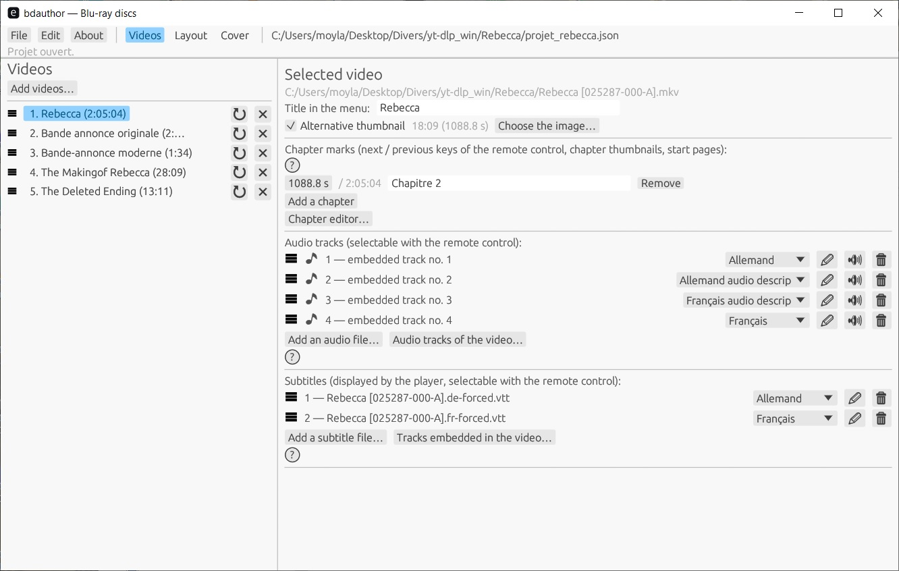
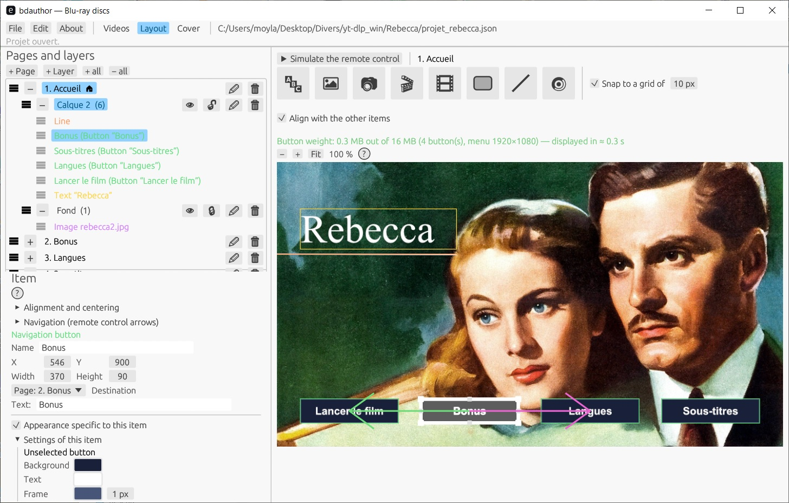
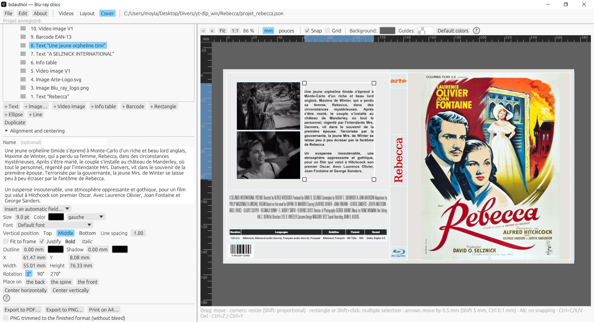

# bdauthor

**Créez de vrais disques Blu-ray à menus (HDMV) depuis vos vidéos, avec un éditeur graphique, sans autre logiciel d'authoring.**

bdauthor prend vos fichiers vidéo, vos pistes audio et vos sous-titres, vous laisse dessiner les menus dans un éditeur visuel, puis produit une arborescence `BDMV` complète (ou une image ISO) lisible par les lecteurs et logiciels de lecture Blu-ray. Il crée aussi la **jaquette et l'étiquette du disque** et les exporte pour l'impression. Il est écrit en **Rust**, pilote **ffmpeg** pour l'encodage, et son cœur n'a **aucune dépendance externe**.

> ⚠️ Projet en développement actif. Les disques générés sont vérifiés par un contrôleur intégré et lus dans VLC ; tous les lecteurs de salon ne sont pas encore testés. Voir [État du projet](#état-du-projet).







---

## Sommaire

- [Fonctionnalités](#fonctionnalités) : [Menus](#menus) · [Vidéo, audio et sous-titres](#vidéo-audio-et-sous-titres) · [Jaquette et étiquette](#jaquette-et-étiquette) · [Disque](#disque) · [Confort](#confort)
- [Réglages](#réglages)
- [Widgets](#widgets)
- [Architecture](#architecture) · [Installation](#installation) · [Utilisation rapide](#utilisation-rapide)
- [Format de projet](#format-de-projet) · [État du projet](#état-du-projet) · [Polices](#polices)

---

## Fonctionnalités

L'application est organisée en onglets : **Vidéos** (contenu du disque), **Menus** (éditeur de menus, onglet *Layout*) et **Jaquette** (jaquette et étiquette), plus les menus **Fichier**, **Édition** et **À propos**.

### Menus
- **Éditeur visuel de menus** : placez, déplacez et redimensionnez les éléments à la souris, avec aimantation, guides et ordre de superposition (devant / derrière). Plusieurs éléments peuvent être sélectionnés ensemble, alignés, centrés et répartis.
- **Pages et calques** : arborescence de pages et de calques, avec renommage, masquage, réordonnancement et « page d'accueil » ; copier, couper, coller des widgets (y compris d'une page à l'autre).
- **Widgets** : voir [Widgets](#widgets).
- **Vrais boutons Blu-ray** : navigation entre boutons calculée automatiquement (ou fixée à la main : haut / bas / gauche / droite), pagination automatique des menus, menus de chapitres avec vignettes.
- **Actions des boutons** : lire une vidéo (depuis le début, depuis un chapitre ou un instant libre), tout lire à la suite, aller à une page, à l'accueil ou à la page précédente / suivante, choisir la langue audio, activer ou masquer les sous-titres ; comportement après la lecture (retour à la page, autre page, rester).
- **Apparence des boutons** : un style de boutons pour tout le projet (voir [Réglages](#réglages)), que chaque bouton peut remplacer.
- **Fonds de menu** : image fixe ou **vidéo de fond animée** (en boucle ou arrêtée sur la dernière image), avec **musique de menu** ou le son de la vidéo ; une valeur par défaut pour le projet et une par page.
- **Séquence d'ouverture** : une vidéo lue avant le menu (sans elle, le disque s'ouvre directement sur le menu).
- **Détection des chevauchements** : un clignotement signale les éléments qui se recouvrent (rouge) ou un texte masqué par un bouton (orange).
- **Aperçu fidèle** : le rendu affiché dans l'éditeur est celui qui sera gravé, plus un **simulateur de navigation** pour tester les boutons avant génération. Le déplacement de l'aperçu se fait en maintenant le clic droit.
- **Lancement automatique par page** : une page peut lancer seule l'un de ses boutons après un délai si le spectateur ne fait rien (le délai est un nombre entier de boucles du fond).
- **Résolution des menus** : 1920×1080 par défaut, ou la taille de la première vidéo, ou une taille personnalisée en 16:9.

### Vidéo, audio et sous-titres
- **Fichiers vidéo** : mp4, mkv, mov, avi, m2ts, mts, ts, webm, wmv, flv, m4v, mpg, mpeg ; réordonnables par glisser-déposer ; une vidéo peut être rechargée pour relire sa durée et ses pistes.
- **Encodage via ffmpeg** (H.264 / AC3) avec réglage de qualité (CRF) et de preset, mode optionnel **remplir le disque** (même débit moyen pour toutes les vidéos, en deux passes, pour utiliser la capacité du disque), **copie des vidéos H.264 conformes Blu-ray** (flux vidéo conservé, audio converti en AC-3) en option, cache d'encodage, annulation, et **progression détaillée** (étape, temps écoulé, estimation du temps restant, détail ffmpeg).
- **Jusqu'à 8 pistes audio par vidéo**, chacune avec sa langue (des pistes peuvent venir d'autres fichiers, avec un décalage) ; réordonnables par glisser-déposer ; fenêtre d'écoute avec forme d'onde pour caler un décalage.
- **Boutons de langue audio** : le disque retient la *langue* choisie et chaque vidéo sélectionne sa propre piste correspondante au démarrage. Une langue audio par défaut est réglée pour le projet.
- **Jusqu'à 8 pistes de sous-titres par vidéo** : fichiers SRT et ASS/SSA, ou sous-titres extraits du fichier vidéo ; détection automatique de l'**encodage du texte** (UTF-8, pages de code Windows, cyrillique, grec, hébreu, arabe, thaï, japonais, chinois, coréen…).
- **Style des sous-titres** : police, taille, couleur, contour, ombre, opacité, boîte de fond à coins arrondis, position, marges, alignement, largeur maximale et retour à la ligne. Une **fenêtre d'aperçu** avec frise de lecture montre le résultat sur l'image de la vidéo, avec la zone de sécurité.
- **Contrôle qualité des sous-titres** : signale vitesse de lecture, longueur de ligne, nombre de lignes, durées d'affichage trop courtes ou trop longues et écarts trop faibles, avec des limites réglables.
- **Liste des langues de sous-titres du projet**, réordonnable par glisser-déposer.
- **Chapitres** manuels ou automatiques (toutes les N secondes) ; un **éditeur de chapitres** avec la vidéo image par image, la lecture et une frise (timecode `hh:mm:ss:ff`), où se placent les chapitres et les vignettes de menu ; un chapitre peut avoir sa propre vignette de page.
- **Vignettes** des frises calculées en parallèle, conservées dans un cache disque et préchargées en arrière-plan : les éditeurs s'ouvrent aussitôt.

### Jaquette et étiquette
- **Éditeur de jaquette** (dos, tranche, face, avec fond perdu) pour boîtiers Blu-ray standard et épais, DVD standard et slim, Blu-ray slim, ou un format personnalisé.
- **Éditeur d'étiquette de disque** (disque avec son trou central).
- **Widgets** : *Texte*, *Image*, *Image de vidéo*, *Tableau d'informations*, *Code-barres*, *Rectangle*, *Ellipse* et *Ligne* (voir [Widgets](#widgets)).
- **Calques** : arborescence pour masquer, verrouiller, renommer et réordonner les éléments ; glissez les éléments d'un calque à l'autre.
- **Repères** : marge de sécurité, aimantation, règles en **mm ou en pouces**, grille optionnelle, couleurs de fond et de repères réglables, déplacement au clic droit, zoom à la molette.
- **Champs automatiques** dans les textes : titre du disque, liste des vidéos (numéro, titre, durée), nombre de vidéos, durée totale, nombre de chapitres, année en cours.
- Alignement d'un ou plusieurs éléments (entre eux ou sur le dos / la tranche / la face / le disque), répartition, duplication, copier-coller, rotation (0°, 90°, 270°), annuler / rétablir.
- Export en **PDF** (taille réelle, ou découpé sur A4 avec traits de coupe), en **PNG** (rogné au format fini, sans fond perdu, en option) ou en **feuille d'impression A4**.

### Disque
- Génération d'un dossier **`BDMV`** complet ou d'une **image ISO** (UDF 2.50), avec nom de volume, propriétaire, organisation et contact, date choisie ou automatique, et options d'agencement (alignement sur 64 Ko, fichiers ordonnés par lecture, compatibilité maximale, copie miroir des métadonnées).
- **Capacité du disque visé** avec marge de sécurité et avertissement si le contenu ne tient pas.
- **Vérificateur intégré** (`bdcheck`) qui contrôle la cohérence du disque produit (index, playlists, clips, menus) et de l'image ISO.
- Fenêtre « Générer le disque » avec journal en direct ; le projet est contrôlé avant la génération.
- Disques **sans zone et sans protection** : ni AACS, ni BD+, ni code de région (A/B/C), donc lisibles sur tout lecteur. Le verrouillage par zone et la protection anti-copie exigent des licences commerciales et ne sont pas gérés.

### Confort
- Interface **bilingue** (français / anglais) ; un fichier de **traduction de l'interface** peut être créé pour ajouter une autre langue (à placer dans le dossier `langues`).
- Projets enregistrés en **JSON lisible** aux clés anglaises ; **projets récents** dans le menu Fichier.
- **Sauvegarde automatique** du projet toutes les quelques minutes, proposée à la restauration après un arrêt inattendu.
- Annuler / rétablir, copier-coller d'éléments, paramètres mémorisés.

---

## Réglages

**Réglages généraux** (*Fichier › Réglages*, conservés sur l'ordinateur, pas dans le projet) :
- **langue** de l'interface ;
- dossier **ffmpeg** (sinon : à côté du programme, puis le `PATH`) ;
- **dossier de polices supplémentaires** (`.ttf` et `.otf` ; ajoutées à toutes les listes de polices ; un « ? » indique les formats pris en charge) ;
- **dossier du cache des vignettes** (taille affichée, boutons « Par défaut », « Vider » et « Ouvrir ») ;
- intervalle de la **sauvegarde automatique** du projet ;
- cadence de rafraîchissement de l'aperçu pendant le glissement ;
- liste des projets récents.

**Réglages du projet** (*Fichier › Projet…*, enregistrés avec le projet) :

| Section | Ce qu'on règle |
|---|---|
| **Disque** | titre du disque, séquence d'ouverture, langue audio par défaut, taille des menus (1920×1080, première vidéo, 16:9 personnalisé) |
| **Encodage** | qualité x264 (CRF) et preset, *remplir le disque* jusqu'à une part de la capacité, copie des vidéos conformes, réutilisation des vidéos déjà encodées (cache) |
| **Fond et musique des menus** | image ou vidéo de fond (en boucle) par défaut, durée, musique, conservation du son de la vidéo |
| **Style des boutons** | aspect non sélectionné / sélectionné / activé de tous les boutons : fond, texte, bordure, assombrissement, halo (pulsation animée), agrandissement, arrondi, sons, images ou animations dessinées en option |
| **Style des pages** | aspect par défaut des pages de menu |
| **Langues des sous-titres** | liste ordonnée des langues de sous-titres |
| **Génération ISO** | produire le dossier BDMV, l'image ISO ou les deux ; nom de volume et métadonnées ; disque visé et limite de remplissage ; version UDF ; options d'agencement ; date |

---

## Widgets

### Widgets de menu

| Widget | Usage |
|---|---|
| **Texte** | texte libre ou cliquable ; police, taille, couleur, alignement, contour, ombre |
| **Image** | image PNG, JPEG ou SVG, cliquable en option |
| **Vignette de vidéo** | une image d'une vidéo, choisie automatiquement ou à un instant précis |
| **Image de vidéo** | n'importe quelle image d'une vidéo, avec recadrage possible |
| **Boutons de navigation** | page précédente / suivante, accueil, tout lire, aller à… |
| **Rectangle** | remplissage, bordure, arrondi, transparence réglable |
| **Ligne** | manipulée par ses deux extrémités ; continue, tirets, points, double ; flèches ; angles à 45° |

### Widgets de jaquette et d'étiquette

| Widget | Usage |
|---|---|
| **Texte** | police, taille, couleur, alignement (gauche / centre / droite), **justification** (texte coupé en lignes de la largeur du cadre, mots espacés pour remplir chaque ligne ; la dernière ligne d'un paragraphe garde son alignement), position verticale, interligne, *ajuster au cadre*, gras, italique, contour, ombre ; champs automatiques |
| **Image** | PNG, JPEG, SVG |
| **Image de vidéo** | une image d'une vidéo du projet (même sélecteur que dans l'éditeur de menus) |
| **Tableau d'informations** | durée, langues, sous-titres, format et son d'une ou plusieurs vidéos, lus dans le projet ; choix et ordre des vidéos (glisser-déposer) et des colonnes, intitulés, une ligne par information, taille, couleurs, fond distinct pour les intitulés et les cases, grille, police |
| **Code-barres** | **Code 128, EAN-13, EAN-8 et UPC-A** dessinés en barres vectorielles ; le chiffre de contrôle est ajouté ou vérifié ; texte lisible avec sa propre police et sa taille ; couleur et fond ; variables comme `{title}` acceptées ; le dessin reste identique à tout zoom ou résolution |
| **Rectangle**, **Ellipse** | remplissage, bordure, arrondi (rectangle) |
| **Ligne** | extrémités, tirets, flèches |

---

## Architecture

| Crate | Rôle | Dépendances |
|---|---|---|
| `bdauthor-core` | Formats Blu-ray (index, MovieObject, playlists, CLPI, M2TS, IG), muxage, modèle de projet, modèle de jaquette et codes-barres, éditeur (géométrie), vérificateur, ISO, JSON, PNG, PDF | **Aucune** (std seulement) |
| `bdauthor-render` | Dessin des menus et des jaquettes (texte, formes, images, SVG) | `image`, `ab_glyph`, `resvg` |
| `bdauthor-gui` | Interface graphique `bdauthor` | `egui` / `eframe`, `rfd` |

Les trois crates forment un seul espace de travail Cargo (`rust/Cargo.toml`).

Outils en ligne de commande fournis : `bdauthor-build` (projet → disque), `bdcheck` (vérification), `bdinspect` (inspection d'un fichier BDMV), `bdiso` (image ISO), `bdauthor-ffmpeg` (tests ffmpeg).

---

## Installation

### Prérequis
- [Rust](https://rustup.rs/) (toolchain stable ; sous Windows, avec les outils MSVC)
- [ffmpeg](https://ffmpeg.org/) **avec `libx264` et l'encodeur `ac3`**, plus `ffprobe` (et `ffplay` pour l'écoute des pistes audio)

ffmpeg est cherché dans cet ordre : le dossier indiqué dans les réglages, à côté de l'exécutable, le dossier indiqué par la variable `BDAUTHOR_FFMPEG_DIR`, puis le `PATH`.

### Compiler et lancer
```bash
cd rust
cargo run --release -p bdauthor-gui
```
Sous Windows, `rust\recompiler.bat` compile tout en mode release et `rust\lancer.bat` démarre l'application.

### Générer un disque en ligne de commande
```bash
cd rust
cargo run --release -p bdauthor-render --bin bdauthor-build -- projet.json dossier_sortie
```

### Tests
```bash
cd rust
cargo test -p bdauthor-core
```

---

## Utilisation rapide

1. **Fichier › Nouveau projet**, puis ajoutez vos vidéos.
2. Pour chaque vidéo : titre, pistes audio (langue), sous-titres, chapitres, image de vignette.
3. Ouvrez l'onglet **Menus** : composez la page (textes, images, boutons, formes), testez avec le simulateur.
4. Réglez la qualité d'encodage et le disque visé dans les réglages du projet.
5. Ouvrez l'onglet **Jaquette** pour dessiner la jaquette et l'étiquette ; exportez-les en PDF ou en PNG.
6. **Générer le disque** : suivez la progression, puis consultez le rapport de vérification.
7. Ouvrez le dossier produit dans VLC, ou gravez l'image ISO.

---

## Format de projet

Les projets sont des fichiers JSON lisibles et éditables à la main (chemins relatifs possibles). Les champs inconnus sont conservés à l'enregistrement.

```json
{
  "title": "Mon disque",
  "language": "fra",
  "videos": [
    { "file": "film1.mp4", "title": "Film 1", "auto_chapters_s": 60 }
  ],
  "encoding": { "crf": 18, "preset": "medium" }
}
```

Les clés sont en anglais. Les projets écrits par les versions précédentes avec des clés françaises (`titre`, `fichier`, `encodage`…) ne sont plus lus.

---

## État du projet

- **Vérifié** : la sortie des fichiers de navigation et du muxage a été comparée octet pour octet à une version de référence et à un disque produit par un autre outil ; le contrôleur intégré valide les disques générés ; lecture OK dans VLC.
- **À valider** : lecture sur lecteurs de salon, comportement des changements de langue audio sur matériel, vidéos sources de cadences variées (PAL, etc.), lecture des codes-barres imprimés avec un vrai lecteur.
- **Limites connues** : les fichiers sont lus en mémoire lors du muxage ; le cache d'encodage ne conserve pas les statistiques d'encodage.

Les notes techniques détaillées (format, pièges, tests) sont dans [`NOTES.md`](NOTES.md).

---

## Polices

bdauthor n'embarque aucune police. Les menus, jaquettes et étiquettes sont dessinés avec un fichier de police trouvé sur l'ordinateur : la variable d'environnement `BDAUTHOR_FONT`, puis les polices du système (Arial, Segoe UI ou Calibri sous Windows ; DejaVu ou Arial ailleurs). Les éléments de texte peuvent utiliser toute police installée, tout fichier `.ttf` / `.otf` du **dossier de polices supplémentaires** des réglages généraux, ou tout fichier de police choisi par *Autre fichier…*. Dans un projet, une police est enregistrée par son nom de fichier : sur un autre ordinateur, placez les mêmes polices dans son dossier de polices supplémentaires. Les polices du système ont leur propre licence ; pour des disques et jaquettes destinés à être diffusés, préférez des polices libres (SIL OFL, par exemple Liberation, DejaVu, Noto).

---

## Contribuer

Les retours, rapports de bugs (idéalement avec le journal de génération) et suggestions sont les bienvenus via les *Issues*.

## Licence

[MIT](LICENSE)
