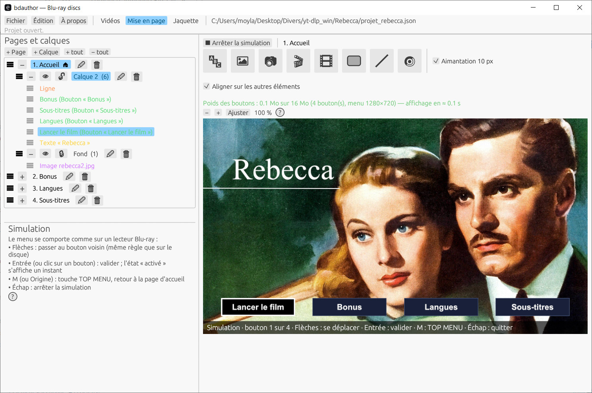

# bdauthor

**Créez de vrais disques Blu-ray à menus (HDMV) depuis vos vidéos, avec un éditeur graphique, sans autre logiciel d'authoring.**

bdauthor prend vos fichiers vidéo, vos pistes audio et vos sous-titres, vous laisse dessiner les menus dans un éditeur visuel, puis produit une arborescence `BDMV` complète (ou une image ISO) lisible par les lecteurs et logiciels de lecture Blu-ray. Il est écrit en **Rust**, pilote **ffmpeg** pour l'encodage, et son cœur n'a **aucune dépendance externe**.

> ⚠️ Projet en développement actif. Les disques générés sont vérifiés par un contrôleur intégré et lus dans VLC ; tous les lecteurs de salon ne sont pas encore testés. Voir [État du projet](#état-du-projet).



---

## Fonctionnalités

### Menus
- **Éditeur visuel de menus** : placez, déplacez et redimensionnez les éléments à la souris, avec aimantation, guides et ordre de superposition (devant / derrière).
- **Widgets** : *Texte*, *Image*, *Vignette de vidéo*, *Boutons de navigation*, *Rectangle* (remplissage, bordure, arrondi, transparence réglable) et *Ligne* (manipulée par ses deux extrémités, tirets, flèches, angles à 45°).
- **Vrais boutons Blu-ray** : navigation entre boutons calculée automatiquement, pagination automatique des menus, menus de chapitres avec vignettes.
- **Détection des chevauchements** : un clignotement signale les éléments qui se recouvrent (rouge) ou un texte masqué par un bouton (orange).
- **Aperçu fidèle** : le rendu affiché dans l'éditeur est celui qui sera gravé, plus un simulateur de navigation pour tester les boutons avant génération.

### Vidéo, audio et sous-titres
- **Encodage via ffmpeg** (H.264 / AC3) avec réglage de qualité (CRF) et de preset, cache d'encodage, annulation, et **progression détaillée** (étape, temps écoulé, estimation du temps restant, détail ffmpeg).
- **Plusieurs pistes audio par vidéo**, chacune avec sa langue ; réordonnables par glisser-déposer ; fenêtre d'écoute avec forme d'onde pour caler un décalage.
- **Boutons de langue audio** : le disque retient la *langue* choisie et chaque vidéo sélectionne sa propre piste correspondante au démarrage.
- **Sous-titres** : pistes avec langue, style de texte réglable, fenêtre d'aperçu avec frise de lecture.
- **Chapitres** manuels ou automatiques, vignettes de menu choisies sur une frise vidéo (aperçu image par image).

### Jaquette
- **Éditeur de jaquette** (dos, tranche, face) avec repères, déplacement au clic droit, couleurs de fond et de repères réglables, export PDF.

### Disque
- Génération d'un dossier **`BDMV`** complet ou d'une **image ISO**.
- **Vérificateur intégré** (`bdcheck`) qui contrôle la cohérence du disque produit (index, playlists, clips, menus).
- Fenêtre « Générer le disque » avec journal en direct.
- Disques **sans zone et sans protection** : ni AACS, ni BD+, ni code de région (A/B/C), donc lisibles sur tout lecteur. Le verrouillage par zone et la protection anti-copie exigent des licences commerciales et ne sont pas gérés.

### Confort
- Interface **bilingue** (français / anglais), projets enregistrés en **JSON lisible**.
- Annuler / rétablir, copier-coller d'éléments, paramètres mémorisés.

---

## Architecture

| Crate | Rôle | Dépendances |
|---|---|---|
| `bdauthor-core` | Formats Blu-ray (index, MovieObject, playlists, CLPI, M2TS, IG), muxage, modèle de projet, éditeur (géométrie), vérificateur, ISO, JSON, PNG | **Aucune** (std seulement) |
| `bdauthor-render` | Dessin des menus (texte, formes, images) | `image`, `ab_glyph` |
| `bdauthor-gui` | Interface graphique `bdauthor` | `egui` / `eframe`, `rfd` |

Outils en ligne de commande fournis : `bdauthor-build` (projet → disque), `bdcheck` (vérification), `bdinspect` (inspection d'un fichier BDMV), `bdiso` (image ISO), `bdauthor-ffmpeg` (tests ffmpeg).

---

## Installation

### Prérequis
- [Rust](https://rustup.rs/) (toolchain stable ; sous Windows, avec les outils MSVC)
- [ffmpeg](https://ffmpeg.org/) **avec `libx264` et l'encodeur `ac3`**, plus `ffprobe` (et `ffplay` pour l'écoute des pistes audio)

ffmpeg est cherché dans cet ordre : à côté de l'exécutable, dans le dossier indiqué par la variable `BDAUTHOR_FFMPEG_DIR`, puis dans le `PATH`.

### Compiler et lancer
```bash
cd rust/bdauthor-gui
cargo run --release
```

### Générer un disque en ligne de commande
```bash
cd rust/bdauthor-render
cargo run --release --bin bdauthor-build -- projet.json dossier_sortie
```

### Tests
```bash
cd rust/bdauthor-core
cargo test
```

---

## Utilisation rapide

1. **Projet › Nouveau**, puis ajoutez vos vidéos.
2. Pour chaque vidéo : titre, pistes audio (langue), sous-titres, chapitres, image de vignette.
3. Ouvrez l'**éditeur de menu** : composez la page (textes, images, boutons, formes), testez avec le simulateur.
4. Réglez la qualité d'encodage dans les paramètres du disque.
5. **Générer le disque** : suivez la progression, puis consultez le rapport de vérification.
6. Ouvrez le dossier produit dans VLC, ou gravez l'image ISO.

---

## Format de projet

Les projets sont des fichiers JSON lisibles et éditables à la main (chemins relatifs possibles). Les champs inconnus sont conservés à l'enregistrement.

```json
{
  "titre": "Mon disque",
  "langue": "fra",
  "videos": [
    { "fichier": "film1.mp4", "titre": "Film 1", "chapitres_auto_s": 60 }
  ],
  "encodage": { "crf": 18, "preset": "medium" }
}
```

---

## État du projet

- **Vérifié** : la sortie des fichiers de navigation et du muxage a été comparée octet pour octet à une version de référence et à un disque produit par un autre outil ; le contrôleur intégré valide les disques générés ; lecture OK dans VLC.
- **À valider** : lecture sur lecteurs de salon, comportement des changements de langue audio sur matériel, vidéos sources de cadences variées (PAL, etc.).
- **Limites connues** : les fichiers sont lus en mémoire lors du muxage ; le cache d'encodage ne conserve pas les statistiques d'encodage.

Les notes techniques détaillées (format, pièges, tests) sont dans [`NOTES.md`](NOTES.md).

---

## Contribuer

Les retours, rapports de bugs (idéalement avec le journal de génération) et suggestions sont les bienvenus via les *Issues*.

## Licence

[MIT](LICENSE)
