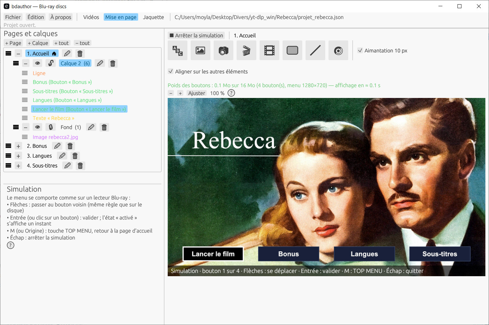

# bdauthor

**Create real Blu-ray discs with menus (HDMV) from your videos, using a graphical editor and no other authoring software.**

bdauthor takes your video files, audio tracks and subtitles, lets you design the menus in a visual editor, then produces a complete `BDMV` folder (or an ISO image) that Blu-ray players and playback software can read. It is written in **Rust**, drives **ffmpeg** for encoding, and its core has **no external dependencies**.

> ⚠️ Under active development. Generated discs are checked by a built-in verifier and play in VLC; not all standalone players have been tested yet. See [Project status](#project-status).



---

## Features

### Menus
- **Visual menu editor**: place, move and resize elements with the mouse, with snapping, guides and stacking order (front / back).
- **Widgets**: *Text*, *Image*, *Video thumbnail*, *Navigation buttons*, *Rectangle* (fill, border, rounded corners, adjustable opacity) and *Line* (edited through its two endpoints; dashes, arrows, 45° angle snapping).
- **Real Blu-ray buttons**: button-to-button navigation computed automatically, automatic menu pagination, chapter menus with thumbnails.
- **Overlap detection**: a blink warns about overlapping elements (red) or text hidden behind a button (orange).
- **Faithful preview**: what the editor shows is what gets authored, plus a navigation simulator to test the buttons before building.

### Video, audio and subtitles
- **Encoding through ffmpeg** (H.264 / AC3) with quality (CRF) and preset settings, an encoding cache, cancellation, and **detailed progress** (step, elapsed time, ETA, ffmpeg detail).
- **Several audio tracks per video**, each with its own language; reorder them by drag and drop; a listening window with a waveform to adjust offsets.
- **Audio language buttons**: the disc remembers the chosen *language*, and each video selects its own matching track at start.
- **Subtitles**: tracks with language, adjustable text style, and a preview window with a playback timeline.
- **Chapters**, manual or automatic; menu thumbnails picked on a video timeline (frame-accurate preview).

### Cover
- **Cover editor** (back, spine, front) with guides, right-button panning, adjustable background and guide colors, PDF export.

### Disc output
- Complete **`BDMV`** folder or **ISO image**.
- **Built-in verifier** (`bdcheck`) that checks the consistency of the generated disc (index, playlists, clips, menus).
- "Generate the disc" window with a live log.
- Discs are **region-free and unprotected**: no AACS, BD+ or region code (A/B/C), so they play on any player. Region locking and copy protection require commercial licences and are not supported.

### Convenience
- **Bilingual interface** (French / English); projects saved as **human-readable JSON**.
- Undo / redo, copy-paste of elements, remembered settings.

---

## Architecture

| Crate | Role | Dependencies |
|---|---|---|
| `bdauthor-core` | Blu-ray formats (index, MovieObject, playlists, CLPI, M2TS, IG), muxing, project model, editor geometry, verifier, ISO, JSON, PNG | **None** (std only) |
| `bdauthor-render` | Menu drawing (text, shapes, images) | `image`, `ab_glyph` |
| `bdauthor-gui` | `bdauthor` graphical application | `egui` / `eframe`, `rfd` |

Command-line tools: `bdauthor-build` (project → disc), `bdcheck` (verification), `bdinspect` (BDMV file inspection), `bdiso` (ISO image), `bdauthor-ffmpeg` (ffmpeg tests).

---

## Installation

### Requirements
- [Rust](https://rustup.rs/) (stable toolchain; on Windows, with the MSVC tools)
- [ffmpeg](https://ffmpeg.org/) **with `libx264` and the `ac3` encoder**, plus `ffprobe` (and `ffplay` for audio track listening)

ffmpeg is looked up in this order: next to the executable, in the folder given by the `BDAUTHOR_FFMPEG_DIR` environment variable, then in the `PATH`.

### Build and run
```bash
cd rust/bdauthor-gui
cargo run --release
```

### Build a disc from the command line
```bash
cd rust/bdauthor-render
cargo run --release --bin bdauthor-build -- project.json output_folder
```

### Tests
```bash
cd rust/bdauthor-core
cargo test
```

---

## Quick start

1. **Project › New**, then add your videos.
2. For each video: title, audio tracks (language), subtitles, chapters, thumbnail image.
3. Open the **menu editor**: lay out the page (text, images, buttons, shapes) and test it with the simulator.
4. Set the encoding quality in the disc settings.
5. **Generate the disc**: follow the progress, then read the verification report.
6. Open the output folder in VLC, or burn the ISO image.

---

## Project format

Projects are readable JSON files you can edit by hand (relative paths allowed). Unknown fields are preserved on save.

```json
{
  "titre": "My disc",
  "langue": "eng",
  "videos": [
    { "fichier": "movie1.mp4", "titre": "Movie 1", "chapitres_auto_s": 60 }
  ],
  "encodage": { "crf": 18, "preset": "medium" }
}
```

Note: JSON keys are in French for historical reasons.

---

## Project status

- **Verified**: navigation files and muxing output were compared byte for byte with a reference implementation and with a disc produced by another tool; the built-in verifier validates generated discs; playback works in VLC.
- **To be validated**: playback on standalone players, audio language switching on real hardware, sources with other frame rates (PAL, etc.).
- **Known limits**: files are read into memory during muxing; the encoding cache does not keep encoding statistics.

Detailed technical notes (format, pitfalls, tests) are in [`NOTES.md`](NOTES.md).

---

## Contributing

Feedback, bug reports (ideally with the build log) and suggestions are welcome through Issues.

## License

[MIT](LICENSE)
